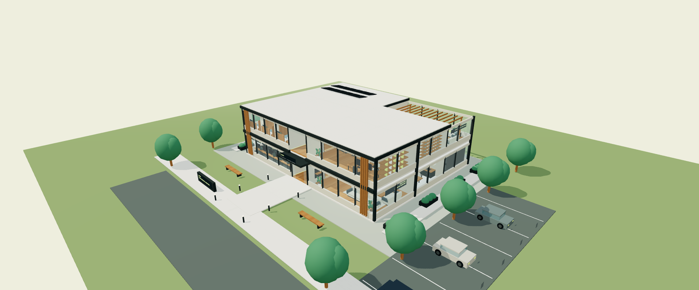

# AZES / Espor Gaming House

Orçun Kamil Kabadayı tarafından tasarlanan iki katlı, gezilebilir 3D espor takım evi konsepti. Three.js ile gerçek hacim içinde dolaşma ve mimari sunum deneyimi.

## Deneyimi açma

[Canlı 3D turu açın](https://www.orcunkamilkabadayi.com/gaming-house/).

Çevrimdışı kullanım için depoyu ZIP olarak indirin ve **AZES-Gaming-House.html** dosyasına çift tıklayın. Motor, model, dokular, arayüz ve araştırma tek dosyaya gömülüdür; kurulum ve internet gerekmez.

## İçerik

- İki kat, 12 ana mekân; 6 oyuncu istasyonu ve ayrı koç masası, 6 yatak.
- Antrenman, VOD analizi, yayın stüdyosu, takım salonu, mutfak ve hareket alanı.
- Oyuncu yaşam bölümleri, bakım/çamaşır, koç/yönetim, sessiz oda ve teras.
- Dış cephe, bahçe, otopark ve giriş düzeni.
- WASD/yön tuşlarıyla yürüyüş; fareyle bakış; merdiven, kapılar ve çarpışma.
- Oda menüsü, kat planı, kat kesiti, sunum, fotoğraf, ses ve gece görünümü.

## Geliştirme

Node.js 22 veya üzeri ile npm install, ardından npm run build ve npm run verify. Kullanım için derleme gerekmez; hazır HTML repodadır. Kaynaklar src/ içinde, araştırma REFERANS-INCELEME.md dosyasındadır.

Bu çalışma özgün bir mimari konsepttir; fotogerçekçi render veya uygulama projesi olarak sunulmaz. Üçüncü taraf Three.js lisansı THIRD-PARTY-LICENSES.txt içinde ve taşınabilir HTML’de korunur.

[Orçun Kamil Kabadayı](https://www.orcunkamilkabadayi.com/) · [A’dan Z’ye Espor](https://www.adanzyeespor.com/)
